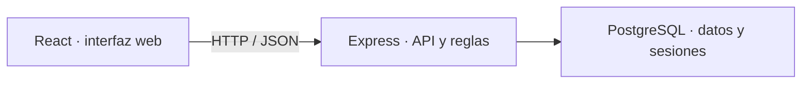

# BarberBook · Taller 3

Proyecto académico de **Desarrollo Web y Móvil**.

**Integrantes:** pendiente de completar por el equipo.

## Qué hace BarberBook

BarberBook organiza las reservas de una barbería y evita que dos atenciones ocupen la misma hora. Los **clientes** eligen servicio, fecha y horario desde el perfil público. El **profesional** revisa las solicitudes y administra su agenda, servicios y jornada.

## Continuidad con el Taller 2

Se mantienen el problema, los usuarios y el diseño original del perfil y las reservas. Esta versión incorpora:

- API propia y datos persistidos en PostgreSQL.
- Disponibilidad calculada según jornada, duración del servicio y reservas existentes.
- Login profesional, confirmación o rechazo de solicitudes y agenda de 14 días.
- Edición de perfil, servicios y semana laboral; aprobación manual o automática.
- Docker Compose y documentación interactiva con Swagger.

## Arquitectura y datos



React muestra las pantallas, Express aplica las reglas y PostgreSQL guarda los datos. El código separa páginas, componentes y servicios HTTP en frontend; rutas, controladores y servicios en backend.

**Tecnologías principales:** React 19, Vite 8, Node.js 24, Express 5, PostgreSQL 17 y OpenAPI 3.0.3. Docker Compose ejecuta tres servicios: frontend servido por Nginx, backend y PostgreSQL.

Las cinco tablas SQL son `professionals`, `services`, `bookings`, `working_hours` y `professional_sessions`. Servicios y jornadas pertenecen a un profesional; las reservas referencian servicios y conservan su nombre, precio y duración históricos. Las sesiones protegen el acceso al panel.

**PostgreSQL es la única base implementada.** NoSQL sigue pendiente.

## Cómo funciona FIFO

Si varias solicitudes compiten por un horario del mismo profesional, tiene prioridad la primera registrada en PostgreSQL. Se ordenan por fecha de registro y, en caso de empate, por ID.

Una posterior no puede adelantarse a otra anterior que se superponga y siga siendo válida. Las solicitudes pasadas, fuera de jornada o incompatibles con reservas confirmadas o completadas no bloquean otra válida. Las horas independientes no compiten.

Al confirmar se revisa otra vez la disponibilidad. Activar el modo automático no confirma las pendientes previas. Se usa la zona horaria **America/Santiago**.

## Cómo ejecutarlo

Se necesita Docker Desktop con el motor Linux activo. Desde la raíz del proyecto, con `.env` y el volumen existentes:

```powershell
docker compose config --quiet
docker compose up --build -d
docker compose ps
Invoke-RestMethod http://localhost:5173/api/health
```

Los tres servicios deben estar saludables y la API responder `status: ok` y `database: connected`.

- Aplicación: http://localhost:5173
- Panel profesional: http://localhost:5173/#/panel/dashboard
- API directa: http://localhost:3003/api/health
- PostgreSQL desde el computador: `127.0.0.1:55434`.

Cerrar antes los servidores npm de este proyecto si ocupan 5173 o 3003. Dentro de Docker, Express usa `postgres:5432`.

Para detener sin borrar datos:

```powershell
docker compose stop
```

El volumen `barberbook-taller-3_barberbook_postgres` conserva los datos. **El arranque normal no carga datos de prueba ni crea credenciales:** no repetir la inicialización en una instalación existente.

<details>
<summary>Primera instalación en un computador nuevo</summary>

Crear `.env` solo si falta y configurar privadamente `POSTGRES_DB`, `POSTGRES_USER` y `POSTGRES_PASSWORD`. `PGHOST` y `PGPORT` se usan con npm; Compose configura la conexión interna.

```powershell
if (-not (Test-Path .env)) { Copy-Item .env.example .env }
```

Después de configurar esos valores, crear el volumen y cargar los datos iniciales **solo para esa instalación nueva**:

```powershell
docker volume create barberbook-taller-3_barberbook_postgres
docker compose up --build -d --wait
docker compose exec backend npm run db:setup
New-Item -ItemType Directory -Force .runtime | Out-Null
docker compose run --rm --no-deps --user root --volume "${PWD}/.runtime:/app/.runtime" backend npm run auth:setup
```

La contraseña profesional queda en `.runtime/auth/matias-login.txt`. No publicarla ni incluirla en capturas. `.env` y `.runtime` se excluyen de Git y de las imágenes. El script conserva las credenciales existentes.

</details>

## API y Swagger

La API permite consultar catálogo y disponibilidad, reservar y administrar los datos propios del profesional.

**Swagger:** http://localhost:5173/api/docs
**OpenAPI JSON:** http://localhost:5173/api/openapi.json

Abrir `GET /services`, pulsar **Try it out** y **Execute**: debe responder 200 con el catálogo. También se puede probar `GET /health`.

Para operaciones privadas, usar el formulario de sesión de Swagger, que gestiona cookie HttpOnly y protección CSRF. **POST, PATCH y PUT modifican datos reales**; evitar reservas de ejemplo en la base de demostración.

## Pruebas realizadas

Última verificación registrada: **15 de noviembre de 2026**, con **51 pruebas backend y 7 frontend aprobadas**, ESLint y build correctos. Cubren persistencia, reservas, conflictos, FIFO, sesiones, permisos, Swagger y reinicio de Docker. Los datos de prueba se crean en bases aisladas; se conservaron las 15 reservas de demostración.

```powershell
npm test --prefix backend
npm test --prefix frontend
npm run lint --prefix frontend
npm run build --prefix frontend
```

Hubo pruebas de navegador en escritorio y móvil; la revisión humana final debe documentarse por separado.

## Uso de Inteligencia Artificial


## Limitaciones conocidas

BarberBook está desarrollado para una demostración académica en un entorno local.

- Se utiliza PostgreSQL como única base de datos. No se implementó MongoDB.
- No se incorporó una API pública externa. Se priorizó la disponibilidad basada en los horarios configurados por el profesional.
- El sistema no está configurado para su publicación en un servidor de producción.

Estas decisiones y limitaciones se consideran dentro del alcance de esta versión.
