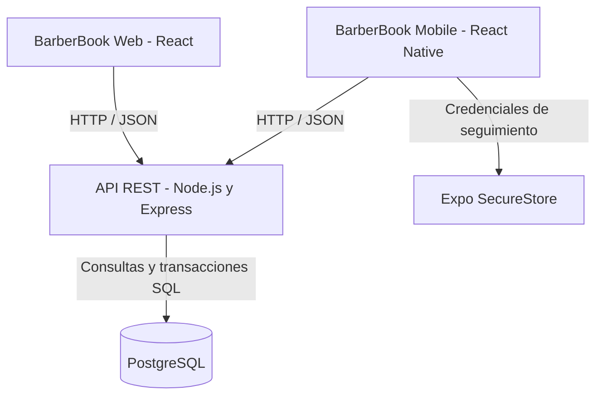

# BarberBook | Hito 4

**Asignatura:** Desarrollo Web y Móvil  
**Estudiante:** Martín Cerpa  
**Proyecto:** BarberBook  
**Periodo:** Segundo semestre de 2026

## 1. Descripción del proyecto

BarberBook es un sistema de gestión de reservas para barberías que permite a los clientes consultar servicios, seleccionar horarios, solicitar horas de atención y gestionar sus propias reservas.

Por otra parte, los profesionales pueden revisar solicitudes, confirmar o rechazar reservas, consultar su agenda y administrar su perfil, servicios, horarios de atención y modalidad de aprobación.

El proyecto cuenta con una aplicación web y una aplicación móvil que utilizan la misma API REST y base de datos, permitiendo mantener la información consistente entre ambas plataformas.

## 2. Evolución del proyecto

El desarrollo de BarberBook se realizó de manera progresiva durante la asignatura.

| Etapa | Desarrollo |
|---|---|
| Taller 2 | Desarrollo del frontend web utilizando React. |
| Hito 3 | Incorporación de un backend propio, API REST, PostgreSQL, Docker y documentación Swagger. |
| Hito 4 | Desarrollo de una aplicación móvil con React Native y Expo, integrada con la arquitectura existente. |

En el Hito 4 se mantuvieron las reglas de negocio del proyecto original, adaptando la interfaz y los principales procesos al contexto de uso móvil.

No se desarrolló un backend independiente para la aplicación móvil.

## 3. Funcionalidades

### Cliente

- Visualización del perfil público del profesional.
- Consulta de servicios, precios y duración.
- Consulta de disponibilidad.
- Selección de fecha y hora.
- Solicitud de reservas.
- Reservas competitivas para un mismo horario.
- Validación de datos de contacto.
- Comprobante de reserva.
- Seguimiento de múltiples reservas.
- Actualización individual y general de estados.
- Cancelación de reservas pendientes o confirmadas.
- Tema claro y oscuro.

### Profesional

- Inicio y cierre de sesión.
- Resumen de la jornada.
- Consulta de solicitudes pendientes.
- Confirmación y rechazo de solicitudes.
- Historial desplegable de solicitudes resueltas.
- Agenda de atenciones de 14 días.
- Edición del perfil público.
- Configuración de servicios existentes.
- Modificación de precios, duración y visibilidad de servicios.
- Configuración de horarios de atención y pausas.
- Aprobación manual o automática de reservas.

## 4. Tecnologías utilizadas

| Componente | Tecnología |
|---|---|
| Frontend web | React 19 y Vite 8 |
| Aplicación móvil | React Native 0.88.1 |
| Entorno móvil | Expo SDK 58 |
| Navegación móvil | Expo Router |
| Almacenamiento seguro móvil | Expo SecureStore |
| Backend | Node.js 24 y Express 5 |
| Base de datos | PostgreSQL 17 |
| Documentación API | Swagger / OpenAPI 3.0.3 |
| Contenedores | Docker y Docker Compose |
| Servidor web | Nginx |
| Control de versiones | Git y GitHub |
| Pruebas | Node.js Test Runner, mocks y PostgreSQL aislado |

Las versiones específicas de las dependencias se encuentran registradas en los archivos `package.json` y `package-lock.json` de cada componente.

## 5. Arquitectura del sistema

La aplicación web y la aplicación móvil funcionan como clientes independientes de una misma API REST.



El backend concentra las reglas de negocio, las validaciones, la autenticación y las operaciones sobre la base de datos.

Cuando un cliente crea una reserva desde la aplicación móvil, la información se envía mediante la API REST y se registra en PostgreSQL. La aplicación web puede consultar posteriormente esa misma reserva.

De igual manera, cuando un profesional modifica el estado de una solicitud desde la web, el cliente puede consultar su nuevo estado desde el dispositivo móvil.

Expo SecureStore se utiliza para conservar las credenciales de seguimiento de las reservas. No reemplaza a PostgreSQL ni constituye una base de datos independiente para la aplicación móvil.

## 6. Estructura del repositorio

```text
BarberBook/
├── frontend/
│   ├── src/
│   ├── test/
│   └── README.md
├── backend/
│   ├── src/
│   │   ├── controllers/
│   │   ├── routes/
│   │   ├── services/
│   │   ├── database/
│   │   └── docs/
│   ├── test/
│   └── README.md
├── mobile/
│   ├── assets/
│   ├── src/
│   │   ├── app/
│   │   ├── components/
│   │   ├── hooks/
│   │   ├── services/
│   │   ├── theme/
│   │   └── utils/
│   ├── test/
│   └── README.md
├── compose.yaml
├── .env.example
└── README.md
```

La separación permite mantener la lógica de presentación de cada plataforma independiente de las reglas de negocio y la persistencia.

## 7. Base de datos

BarberBook utiliza PostgreSQL como sistema de persistencia compartido.

| Tabla | Propósito |
|---|---|
| `professionals` | Información y configuración de los profesionales. |
| `services` | Servicios ofrecidos, precios, duración y visibilidad. |
| `bookings` | Reservas, horarios, estados y datos históricos del servicio. |
| `working_hours` | Jornadas y horarios de atención. |
| `professional_sessions` | Sesiones de autenticación profesional. |
| `booking_tracking_credentials` | Hash de las credenciales de seguimiento de cada reserva. |

Los datos se conservan mediante un volumen de Docker, permitiendo mantener la información después de detener o reiniciar los contenedores.

La aplicación móvil no se conecta directamente a PostgreSQL. Todas las consultas y modificaciones se realizan mediante Express y su API REST.

## 8. Reglas de negocio

### Reservas competitivas

BarberBook permite que varios clientes soliciten un mismo horario mientras las solicitudes se encuentren pendientes.

La existencia de una solicitud pendiente no implica que el horario esté reservado definitivamente.

Una vez confirmada una reserva, el backend impide confirmar otra atención que ocupe un intervalo incompatible.

### Política FIFO

Para gestionar solicitudes competidoras, BarberBook utiliza una política FIFO (First In, First Out).

Las solicitudes pendientes que siguen siendo elegibles tienen prioridad según su fecha de creación y, en caso de empate, su identificador.

Antes de confirmar una solicitud, el backend comprueba nuevamente la disponibilidad del profesional.

Las solicitudes anteriores que ya no son elegibles no bloquean otras solicitudes válidas.

### Estados de las reservas

| Estado | Descripción |
|---|---|
| `pending` | Solicitud pendiente de aprobación. |
| `confirmed` | Reserva confirmada por el profesional o mediante aprobación automática. |
| `rejected` | Solicitud rechazada. |
| `cancelled` | Reserva cancelada. |
| `completed` | Atención registrada como completada. |

### Cancelación

El cliente puede cancelar reservas pendientes o confirmadas.

La cancelación modifica el estado de la reserva en PostgreSQL, sin eliminar físicamente el registro.

Una vez confirmada la cancelación, la aplicación móvil retira la reserva de la sección Mis reservas, mientras que el profesional puede mantener su registro en el historial.

Cancelar una reserva no confirma automáticamente otra solicitud competidora.

### Zona horaria

Las fechas y horas de atención se presentan utilizando la zona horaria `America/Santiago`.

## 9. Seguridad y autenticación

### Autenticación profesional

El acceso al panel profesional utiliza sesiones gestionadas por el backend.

La autenticación incorpora:

- Cookies HttpOnly.
- Sesiones almacenadas en PostgreSQL.
- Protección CSRF en operaciones que modifican información.
- Validación de permisos según el profesional autenticado.
- Revocación de sesión al cerrar sesión.

El backend verifica que cada profesional solamente pueda acceder y modificar la información que le corresponde.

### Seguimiento de reservas

Cada reserva recibe una credencial independiente de seguimiento, denominada `trackingToken`.

El backend genera un token aleatorio de 32 bytes y almacena su hash SHA-256 en PostgreSQL.

La aplicación móvil conserva las credenciales mediante Expo SecureStore.

Para consultar o cancelar una reserva, se requiere su identificador y su correspondiente credencial de seguimiento.

```http
Authorization: Bearer <trackingToken>
```

Este mecanismo evita que una persona pueda consultar o cancelar reservas ajenas utilizando únicamente su identificador, nombre o teléfono.

### Mis reservas

La aplicación móvil conserva múltiples credenciales de seguimiento, permitiendo consultar varias reservas desde una misma instalación.

Las reservas se organizan cronológicamente, mostrando primero las próximas atenciones.

El usuario puede desplazarse horizontalmente entre las tarjetas y actualizar sus estados.

En caso de errores de conexión, las credenciales existentes se conservan y la aplicación permite reintentar la consulta.

El historial disponible depende de las credenciales conservadas en el dispositivo y de la dirección de API configurada.

## 10. API REST

La aplicación móvil consume los siguientes endpoints del backend compartido.

### Catálogo y reservas

| Método | Endpoint | Propósito |
|---|---|---|
| GET | `/api/professionals` | Consultar profesionales. |
| GET | `/api/services` | Consultar servicios activos. |
| GET | `/api/availability` | Consultar disponibilidad. |
| POST | `/api/bookings` | Crear una reserva. |
| GET | `/api/bookings/:id/tracking` | Consultar una reserva propia. |
| POST | `/api/bookings/:id/cancel` | Cancelar una reserva propia. |

Las operaciones de seguimiento y cancelación requieren el token asociado a la reserva.

### Autenticación profesional

| Método | Endpoint | Propósito |
|---|---|---|
| POST | `/api/auth/login` | Iniciar sesión. |
| GET | `/api/auth/session` | Consultar la sesión actual. |
| POST | `/api/auth/logout` | Cerrar sesión. |

### Gestión profesional

| Método | Endpoint | Propósito |
|---|---|---|
| GET | `/api/professional/bookings` | Consultar solicitudes y reservas. |
| PATCH | `/api/professional/bookings/:id/status` | Confirmar o rechazar solicitudes. |
| GET | `/api/professional/agenda` | Consultar la agenda. |
| GET | `/api/professional/profile` | Consultar el perfil profesional. |
| PATCH | `/api/professional/profile` | Actualizar el perfil. |
| GET | `/api/professional/services` | Consultar los servicios del profesional. |
| PATCH | `/api/professional/services/:id` | Modificar un servicio existente. |
| GET | `/api/professional/working-hours` | Consultar horarios de atención. |
| PUT | `/api/professional/working-hours` | Actualizar la jornada semanal. |
| PATCH | `/api/professional/settings` | Modificar la modalidad de aprobación. |

Las operaciones profesionales requieren una sesión válida. Las operaciones de escritura incorporan adicionalmente la protección CSRF.

La documentación interactiva y los contratos de la API se encuentran disponibles mediante Swagger/OpenAPI.

## 11. Requisitos de instalación

Para ejecutar el proyecto se necesita:

- Git.
- Node.js compatible con las dependencias del proyecto.
- npm.
- Docker Desktop con el motor de contenedores Linux activo.
- Expo Go compatible con el SDK del proyecto para las pruebas móviles.
- Un dispositivo Android o emulador compatible.
- Conexión a la misma red local entre el computador y el dispositivo físico.

## 12. Instalación y ejecución

### 12.1. Clonar el repositorio

```bash
git clone -b feat/hito4-mobile https://github.com/MartinCerpa/BarberBook-Taller3-Corregido.git
cd BarberBook-Taller3-Corregido
```

Si el repositorio ya se encuentra descargado, ingresar a su carpeta raíz.

### 12.2. Configuración inicial

Crear el archivo `.env` a partir de `.env.example` únicamente si todavía no existe.

Desde PowerShell:

```powershell
if (-not (Test-Path .env)) {
    Copy-Item .env.example .env
}
```

Configurar las variables de PostgreSQL según el entorno local.

No publicar las credenciales ni incorporar archivos `.env` con información privada al repositorio.

### 12.3. Primera instalación de la base de datos

Estos pasos deben realizarse únicamente en una instalación nueva.

```powershell
docker volume create barberbook-taller-3_barberbook_postgres
docker compose up --build -d --wait
docker compose exec backend npm run db:setup
```

Para preparar el acceso profesional:

```powershell
New-Item -ItemType Directory -Force .runtime | Out-Null

docker compose run --rm --no-deps --user root --volume "${PWD}/.runtime:/app/.runtime" backend npm run auth:setup
```

Las credenciales generadas se encuentran en:

```text
.runtime/auth/matias-login.txt
```

Este archivo debe mantenerse privado.

No repetir la inicialización de datos en una instalación existente.

### 12.4. Iniciar los servicios

Desde la raíz del repositorio:

```bash
docker compose up --build -d
```

Comprobar el estado de los contenedores:

```bash
docker compose ps
```

Verificar el funcionamiento del backend:

```bash
curl http://localhost:3003/api/health
```

Respuesta esperada:

```json
{
  "status": "ok",
  "database": "connected"
}
```

### 12.5. Servicios disponibles

| Servicio | Dirección local |
|---|---|
| Aplicación web | http://localhost:5173 |
| Panel profesional web | http://localhost:5173/#/panel/dashboard |
| API REST | http://localhost:3003/api |
| Estado de la API | http://localhost:3003/api/health |
| Swagger | http://localhost:5173/api/docs |
| OpenAPI JSON | http://localhost:5173/api/openapi.json |
| PostgreSQL | `127.0.0.1:55434` |

Docker Compose ejecuta el frontend web, el backend y PostgreSQL.

La aplicación móvil se ejecuta de manera independiente mediante Expo.

## 13. Ejecución de BarberBook Mobile

### 13.1. Configuración de red

Para utilizar la aplicación desde un teléfono físico, el computador y el teléfono deben estar conectados a la misma red local.

En Windows, ejecutar:

```bash
ipconfig
```

Identificar la dirección IPv4 del adaptador de red utilizado.

El archivo `compose.yaml` publicado restringe inicialmente el acceso al backend mediante loopback.

Para realizar pruebas desde un teléfono físico, modificar localmente la publicación del puerto del backend para permitir el acceso desde la red privada de pruebas.

Configuración original:

```yaml
ports:
  - "127.0.0.1:3003:3003"
```

Configuración de demostración en una red local controlada:

```yaml
ports:
  - "0.0.0.0:3003:3003"
```

También es posible utilizar específicamente la dirección IPv4 del adaptador del computador.

Mantener el puerto de PostgreSQL restringido a loopback y limitar mediante el firewall el acceso al backend a la red privada de pruebas.

Después del cambio, reconstruir el backend:

```bash
docker compose up -d --build backend
```

### 13.2. Configurar la dirección de la API

Dentro de la carpeta `mobile/`, crear un archivo denominado `.env.local`.

```dotenv
EXPO_PUBLIC_API_URL=http://IP_DEL_PC:3003/api
```

Reemplazar `IP_DEL_PC` por la dirección IPv4 correspondiente.

Esta variable debe contener únicamente la dirección de la API. No debe incluir contraseñas ni credenciales privadas.

Desde el navegador del teléfono, comprobar el acceso a:

```text
http://IP_DEL_PC:3003/api/health
```

La respuesta debe indicar que el backend está operativo y conectado a la base de datos.

### 13.3. Instalar las dependencias móviles

Desde la raíz del repositorio:

```bash
cd mobile
npm ci
```

### 13.4. Iniciar Expo

```bash
npm start -- --clear
```

Una vez iniciado Metro, abrir Expo Go desde el dispositivo Android y escanear el código QR generado.

La aplicación se cargará utilizando el backend configurado.

Para obtener instrucciones adicionales, consultar el [README de BarberBook Mobile](mobile/README.md).

## 14. Demostración del sistema

### Flujo del cliente

1. Abrir BarberBook Mobile desde Expo Go.
2. Consultar el perfil y los servicios del profesional.
3. Seleccionar un servicio.
4. Elegir fecha y hora.
5. Completar los datos de contacto.
6. Revisar y enviar la solicitud.
7. Consultar el comprobante de reserva.
8. Ingresar a Mis reservas.
9. Actualizar el estado o cancelar la reserva cuando corresponda.

### Flujo del profesional

1. Ingresar al panel profesional.
2. Iniciar sesión.
3. Consultar el resumen de la jornada.
4. Revisar las solicitudes pendientes.
5. Confirmar o rechazar una solicitud.
6. Consultar el historial.
7. Revisar la agenda.
8. Acceder a Ajustes y modificar la configuración disponible.

### Consistencia entre web y móvil

Para comprobar la persistencia compartida:

1. Crear una reserva con datos ficticios desde el móvil.
2. Identificar su número de reserva.
3. Consultar la misma reserva desde el panel web.
4. Confirmar la solicitud desde la web.
5. Actualizar su estado desde Mis reservas.
6. Comprobar que la información coincide entre ambas plataformas.

También se puede cancelar una reserva desde el móvil y verificar que el cambio se refleja en el historial profesional y en la disponibilidad correspondiente.

### Validaciones

La aplicación contempla:

- Campos obligatorios.
- Validación de datos de contacto.
- Horarios no disponibles.
- Conflictos de reservas.
- Errores de conexión.
- Credenciales incorrectas.
- Sesiones vencidas.
- Confirmación de operaciones.
- Estados de carga y ausencia de resultados.

## 15. Pruebas realizadas

Durante el desarrollo se realizaron comprobaciones automatizadas y revisiones funcionales de la aplicación.

| Comprobación | Resultado reportado |
|---|---|
| Pruebas backend con PostgreSQL aislado | 56 aprobadas |
| Pruebas móviles de reservas y cancelación | 23 aprobadas |
| Pruebas móviles del panel profesional | 7 aprobadas |
| Pruebas del frontend web | 7 aprobadas |
| ESLint móvil | Aprobado |
| Comprobación TypeScript | Aprobada |
| Compatibilidad de dependencias Expo | Aprobada |
| Generación de bundles Android e iOS | Aprobada |
| Validación OpenAPI | Aprobada |

Los resultados corresponden a distintas etapas del desarrollo.

Durante la auditoría final se ejecutaron nuevamente las 30 pruebas móviles con mocks, las 7 pruebas web, ESLint, TypeScript y la validación OpenAPI.

Las 56 pruebas de backend y la generación de bundles fueron reportadas durante el sprint anterior. No se repitieron las pruebas que escriben en PostgreSQL durante la auditoría de solo lectura.

Las pruebas automatizadas no reemplazan la validación final en un dispositivo físico.

### Ejecutar pruebas del backend

```bash
npm test --prefix backend
```

### Ejecutar pruebas del frontend web

```bash
npm test --prefix frontend
```

### Ejecutar pruebas móviles

```bash
cd mobile
npm run test:booking-tracking
npm run test:professional-panel
npm run lint
npm run typecheck
npx expo install --check
```

Las pruebas deben ejecutarse con las dependencias instaladas y utilizando entornos de prueba apropiados.

## 16. Control de versiones

El proyecto utiliza Git y GitHub para registrar las diferentes etapas del desarrollo.

La implementación del Hito 4 se encuentra en la rama:

```text
feat/hito4-mobile
```

Durante el desarrollo se realizaron commits independientes para organizar las funcionalidades y facilitar la revisión de los cambios.

Entre los principales avances se encuentran:

- Implementación de la aplicación móvil.
- Integración con la API REST existente.
- Flujo de creación de reservas.
- Seguimiento seguro de reservas.
- Corrección de navegación profesional.
- Implementación de Mis reservas.
- Cancelación de reservas.
- Mejoras del panel profesional y ajustes.

Repositorio:

https://github.com/MartinCerpa/BarberBook-Taller3-Corregido

Rama correspondiente al Hito 4:

https://github.com/MartinCerpa/BarberBook-Taller3-Corregido/tree/feat/hito4-mobile

## 17. Uso de inteligencia artificial

Durante el desarrollo utilicé herramientas de inteligencia artificial como apoyo para la planificación, implementación, revisión y documentación del proyecto.

| Herramienta | Uso |
|---|---|
| ChatGPT | Análisis del enunciado, planificación de funcionalidades, definición de reglas de negocio, preparación de instrucciones y apoyo en la resolución de errores. |
| Codex | Auditoría del código, implementación de funcionalidades, corrección de errores, generación de pruebas y revisión técnica del repositorio. |
| Modern Web Guidance | Referencia para buenas prácticas de formularios, accesibilidad, adaptación de interfaces y experiencia de usuario. |

El trabajo se organizó por etapas, realizando revisiones antes de guardar los avances mediante commits.

Durante el desarrollo probé la aplicación utilizando Expo Go en Android, lo que permitió identificar problemas de conexión, navegación, diseño y comportamiento de las reservas.

Las recomendaciones de Modern Web Guidance se utilizaron como referencia y se adaptaron a los componentes nativos de React Native.

Las comprobaciones automatizadas complementaron las revisiones realizadas en el dispositivo físico.

La responsabilidad sobre las decisiones, revisión y presentación del proyecto corresponde al estudiante.

## 18. Limitaciones y mejoras futuras

La versión actual de BarberBook está orientada a una demostración académica.

Entre sus limitaciones se encuentran:

- PostgreSQL es la única base de datos implementada. No se incorporó MongoDB.
- La aplicación consulta el número y estado de las reservas, pero no calcula una posición explícita dentro de una fila de turnos.
- El seguimiento de reservas depende de las credenciales conservadas en el dispositivo.
- No existe sincronización del historial de reservas entre distintos dispositivos.
- Las reservas antiguas sin credenciales de seguimiento no pueden recuperarse automáticamente desde el móvil.
- Las operaciones requieren conexión con el backend.
- La aplicación móvil permite editar servicios existentes, pero no incorpora todas las operaciones administrativas disponibles en la versión web.
- La configuración HTTP local está destinada exclusivamente a demostraciones controladas con datos ficticios.
- El proyecto todavía no está preparado para un entorno de producción.

Como mejoras futuras se consideran:

- Incorporación de cuentas para clientes.
- Sincronización de reservas entre dispositivos.
- Recuperación segura de credenciales de seguimiento.
- Notificaciones de cambios de estado.
- Ampliación de las funciones de administración profesional.
- Despliegue mediante HTTPS en un servidor de producción.

## 19. Documentación complementaria

- [Documentación de la aplicación móvil](mobile/README.md)
- [Documentación del backend](backend/README.md)
- [Documentación del frontend web](frontend/README.md)
- Swagger: http://localhost:5173/api/docs

## 20. Detener el proyecto

Para detener los servicios sin eliminar la información almacenada:

```bash
docker compose stop
```

Para detener Metro, utilizar `Ctrl + C` en la terminal donde se ejecuta Expo.

El volumen de PostgreSQL conserva la información registrada.

## 21. Resultado del Hito 4

BarberBook evolucionó desde una aplicación web hacia un sistema que permite gestionar reservas desde dispositivos móviles.

La aplicación desarrollada con React Native mantiene la integración con la API REST del Hito 3, reutilizando las reglas de negocio, los servicios y la persistencia existente.

El cliente puede solicitar, consultar y cancelar sus reservas, mientras que el profesional puede gestionar solicitudes, revisar su agenda y modificar su configuración desde el dispositivo móvil.

De esta manera, el proyecto permite utilizar dos interfaces diferentes sobre una misma arquitectura y una fuente de información compartida.