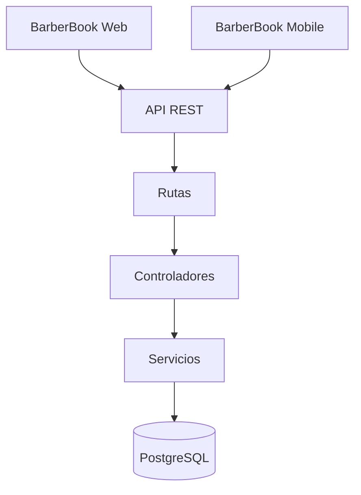

# BarberBook Backend

API REST compartida por BarberBook Web y BarberBook Mobile.

**Estudiante:** Martín Cerpa  
**Asignatura:** Desarrollo Web y Móvil

## Descripción

El backend de BarberBook concentra las reglas de negocio, la autenticación, la gestión de reservas, la disponibilidad de horarios y las operaciones de persistencia.

Fue desarrollado durante el Hito 3 y reutilizado en el Hito 4 para incorporar la aplicación móvil sin crear un servidor independiente.

Ambos clientes consumen la misma API REST y utilizan PostgreSQL como fuente compartida de información.

## Tecnologías

- Node.js 24.
- Express 5.
- PostgreSQL 17.
- Driver `pg`.
- Swagger UI.
- OpenAPI 3.0.3.
- Docker y Docker Compose.
- Node.js Test Runner.

## Arquitectura



Las rutas reciben las solicitudes HTTP, los controladores gestionan las entradas y respuestas, y los servicios implementan las reglas de negocio y las operaciones sobre PostgreSQL.

## Estructura

```text
backend/
├── src/
│   ├── controllers/
│   ├── database/
│   ├── docs/
│   ├── routes/
│   └── services/
├── test/
├── package.json
├── Dockerfile
└── README.md
```

## Base de datos

PostgreSQL almacena la información del sistema mediante seis tablas principales.

| Tabla | Descripción |
|---|---|
| `professionals` | Perfiles y configuración de profesionales. |
| `services` | Servicios, precios, duración y visibilidad. |
| `bookings` | Reservas y estados de atención. |
| `working_hours` | Horarios de atención y pausas. |
| `professional_sessions` | Sesiones profesionales. |
| `booking_tracking_credentials` | Hash de las credenciales de seguimiento de reservas. |

El esquema permite conservar información histórica de los servicios asociados a las reservas.

La información persiste en el volumen Docker:

```text
barberbook-taller-3_barberbook_postgres
```

PostgreSQL es la única base de datos implementada en esta versión.

## Instalación y ejecución

La ejecución recomendada utiliza Docker Compose desde la raíz del repositorio.

Configurar previamente el archivo `.env`, utilizando `.env.example` como referencia.

En una instalación nueva, seguir las instrucciones de inicialización del [README principal](../README.md).

Para iniciar el backend y sus dependencias:

```bash
docker compose up -d --build backend
```

Para iniciar el sistema completo:

```bash
docker compose up -d --build
```

Comprobar el estado de los contenedores:

```bash
docker compose ps
```

## Estado del servicio

Consultar:

```bash
curl http://localhost:3003/api/health
```

Respuesta esperada:

```json
{
  "status": "ok",
  "database": "connected"
}
```

## Conexión con PostgreSQL

Dentro de Docker, el backend utiliza el nombre del servicio `postgres` para acceder a la base de datos.

| Configuración | Valor |
|---|---|
| Host interno | `postgres` |
| Puerto interno | `5432` |
| Puerto publicado en el computador | `55434` |
| Puerto de Express | `3003` |

Las credenciales se configuran mediante variables de entorno.

La aplicación móvil no se conecta directamente a PostgreSQL.

## API REST

La API utiliza solicitudes HTTP y respuestas JSON.

### Endpoints públicos

| Método | Endpoint | Propósito |
|---|---|---|
| GET | `/api/health` | Comprobar el estado del sistema. |
| GET | `/api/professionals` | Consultar profesionales. |
| GET | `/api/services` | Consultar servicios disponibles. |
| GET | `/api/availability` | Consultar disponibilidad. |
| POST | `/api/bookings` | Registrar una reserva. |

### Seguimiento de reservas

| Método | Endpoint | Propósito |
|---|---|---|
| GET | `/api/bookings/:id/tracking` | Consultar una reserva propia. |
| POST | `/api/bookings/:id/cancel` | Cancelar una reserva propia. |

Estas operaciones requieren una credencial Bearer asociada a la reserva.

### Autenticación profesional

| Método | Endpoint | Propósito |
|---|---|---|
| POST | `/api/auth/login` | Iniciar sesión. |
| GET | `/api/auth/session` | Consultar sesión actual. |
| POST | `/api/auth/logout` | Revocar la sesión. |

### Endpoints profesionales

| Método | Endpoint | Propósito |
|---|---|---|
| GET | `/api/professional/bookings` | Consultar solicitudes y reservas. |
| PATCH | `/api/professional/bookings/:id/status` | Confirmar o rechazar. |
| GET | `/api/professional/agenda` | Consultar agenda. |
| GET | `/api/professional/profile` | Consultar perfil. |
| PATCH | `/api/professional/profile` | Actualizar perfil. |
| GET | `/api/professional/services` | Consultar servicios. |
| POST | `/api/professional/services` | Crear un servicio. |
| PATCH | `/api/professional/services/:id` | Actualizar un servicio. |
| GET | `/api/professional/working-hours` | Consultar jornada. |
| PUT | `/api/professional/working-hours` | Actualizar jornada. |
| PATCH | `/api/professional/settings` | Configurar aprobación. |

Las rutas profesionales requieren una sesión válida. Las operaciones de escritura requieren adicionalmente protección CSRF.

El inventario específico de endpoints utilizados por React Native se encuentra en la [documentación móvil](../mobile/README.md).

## Swagger y OpenAPI

La documentación interactiva está disponible en:

http://localhost:5173/api/docs

El documento OpenAPI se encuentra en:

http://localhost:5173/api/openapi.json

Swagger permite consultar los contratos de la API, sus parámetros, respuestas y mecanismos de autenticación.

Las operaciones POST, PATCH y PUT pueden modificar información almacenada. Deben utilizarse únicamente con datos ficticios durante las pruebas.

## Disponibilidad

El backend calcula los horarios disponibles considerando:

- Jornada configurada por el profesional.
- Pausas dentro de la jornada.
- Duración del servicio.
- Fecha y hora solicitadas.
- Reservas existentes.
- Solapamiento de intervalos.

La aplicación web y la aplicación móvil consultan la disponibilidad mediante el mismo endpoint.

El backend vuelve a validar la disponibilidad antes de registrar o confirmar una reserva.

## Reservas competitivas y FIFO

BarberBook permite registrar varias solicitudes pendientes para un mismo horario.

Cuando dos solicitudes elegibles se solapan, se aplica una política FIFO basada en la fecha de creación y, en caso de empate, el identificador de la reserva.

Las solicitudes anteriores que ya no son elegibles no bloquean otras solicitudes válidas.

Las reservas confirmadas o completadas impiden confirmar atenciones que ocupen intervalos incompatibles.

El backend utiliza transacciones y bloqueos para proteger las operaciones concurrentes y mantener la consistencia de la información.

## Estados de reserva

| Estado | Descripción |
|---|---|
| `pending` | Pendiente de aprobación. |
| `confirmed` | Reserva confirmada. |
| `rejected` | Solicitud rechazada. |
| `cancelled` | Reserva cancelada. |
| `completed` | Atención registrada como completada. |

La existencia de un estado en el modelo de datos no implica que todas sus transiciones estén disponibles desde la interfaz profesional.

La modalidad de aprobación automática se aplica a nuevas solicitudes y no confirma automáticamente las solicitudes pendientes anteriores.

## Seguimiento seguro

Durante el Hito 4 se incorporó un mecanismo de seguimiento independiente para cada reserva.

Cuando se registra una reserva, el backend genera una credencial aleatoria de 32 bytes.

El hash SHA-256 de esta credencial se almacena en PostgreSQL, asociado al identificador de la reserva.

La credencial original se entrega al cliente y permite realizar consultas autorizadas mediante:

```http
Authorization: Bearer <trackingToken>
```

El servidor comprueba la combinación del identificador y el hash de la credencial antes de entregar información.

La respuesta de seguimiento contiene el identificador, estado, fecha y hora, nombre del profesional y nombre del servicio.

No se entregan los datos de contacto del cliente mediante este endpoint.

## Cancelación de reservas

La cancelación utiliza el endpoint:

```http
POST /api/bookings/:id/cancel
```

El servidor verifica la credencial de seguimiento y comprueba el estado actual de la reserva.

Las reservas pendientes o confirmadas pueden cancelarse.

Repetir una cancelación ya completada devuelve un resultado exitoso sin duplicar la operación.

Las reservas rechazadas o completadas no pueden cancelarse mediante este flujo.

La cancelación actualiza el estado del registro sin eliminarlo de PostgreSQL.

Una cancelación no confirma automáticamente las demás solicitudes competidoras.

## Autenticación y autorización

El acceso profesional utiliza sesiones almacenadas en PostgreSQL.

Los mecanismos implementados incluyen:

- Cookies HttpOnly.
- Cookies SameSite.
- Validación de sesión.
- Protección CSRF.
- Control de acceso según el profesional autenticado.
- Revocación de sesión.

Las operaciones profesionales que modifican información requieren la cabecera:

```http
X-CSRF-Token: <csrfToken>
```

Las credenciales profesionales y las variables de entorno deben mantenerse fuera del repositorio.

## Integración con la aplicación móvil

React Native consume los endpoints mediante solicitudes HTTP y no accede directamente a PostgreSQL.

El Hito 4 incorporó al backend existente las operaciones de seguimiento y cancelación de reservas.

El resto de las operaciones reutiliza la lógica desarrollada durante el Hito 3.

La configuración de red necesaria para conectar un dispositivo físico se encuentra en el [README móvil](../mobile/README.md).

## Pruebas

Desde la raíz del proyecto, ejecutar:

```bash
npm test --prefix backend
```

Las pruebas requieren las dependencias instaladas y la configuración de un entorno apropiado con PostgreSQL.

Las comprobaciones de integración deben realizarse utilizando bases de prueba aisladas.

Durante el sprint de desarrollo móvil se reportaron 56 pruebas de backend aprobadas.

Las pruebas cubren aspectos relacionados con:

- Creación de reservas.
- Disponibilidad.
- Solicitudes competitivas.
- Política FIFO.
- Autenticación.
- Autorización.
- Protección CSRF.
- Seguimiento de reservas.
- Cancelación.
- Documentación OpenAPI.
- Persistencia.

Durante la auditoría final se validó nuevamente OpenAPI. Las pruebas que escriben en PostgreSQL no se repitieron debido al alcance de solo lectura de esa auditoría.

## Limitaciones

- PostgreSQL es la única base de datos implementada.
- No existe una posición de turno explícita en la respuesta de seguimiento.
- La recuperación de reservas depende de la credencial correspondiente.
- El proyecto está configurado para una demostración académica local.
- Algunos límites de los datos de contacto requieren validaciones adicionales en el backend antes de utilizarse en producción.
- La comunicación con datos reales debe realizarse mediante HTTPS.

## Detener el servicio

Desde la raíz del repositorio:

```bash
docker compose stop
```

La información permanece almacenada en el volumen de PostgreSQL.

## Documentación complementaria

- [README principal](../README.md)
- [BarberBook Mobile](../mobile/README.md)
- [BarberBook Web](../frontend/README.md)

## Autor

Martín Cerpa.

Desarrollo Web y Móvil, segundo semestre de 2026.