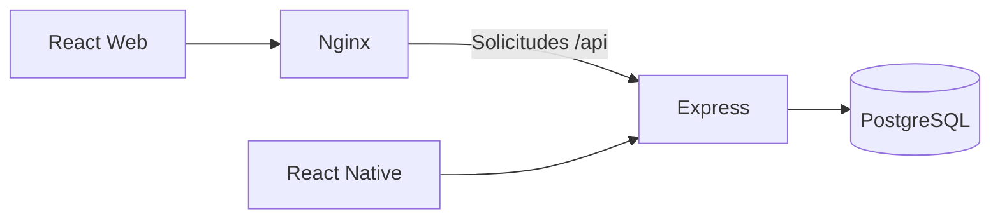

# BarberBook Web

Aplicación web de BarberBook desarrollada con React y Vite.

**Estudiante:** Martín Cerpa  
**Asignatura:** Desarrollo Web y Móvil

## Descripción

BarberBook Web permite gestionar las reservas de una barbería mediante una interfaz pública para clientes y un panel privado para profesionales.

La aplicación fue desarrollada durante el Taller 2 y el Hito 3. En el Hito 4 se incorporó una aplicación móvil que utiliza el mismo backend y la misma base de datos.

## Tecnologías

- React 19.
- Vite 8.
- JavaScript.
- Nginx.
- Docker.
- ESLint.

## Funcionalidades

### Cliente

- Consulta del perfil público del profesional.
- Visualización del catálogo de servicios.
- Consulta de precios y duración.
- Consulta de disponibilidad.
- Selección de fecha y hora.
- Solicitud de reservas.
- Validación de formularios.

### Profesional

- Inicio y cierre de sesión.
- Resumen de la jornada.
- Gestión de solicitudes pendientes.
- Confirmación y rechazo de reservas.
- Consulta de agenda.
- Administración del perfil público.
- Creación y modificación de servicios.
- Configuración de horarios de atención.
- Aprobación manual o automática.

## Arquitectura

BarberBook Web consume la API REST desarrollada con Node.js y Express.

Nginx sirve la aplicación web dentro de Docker y reenvía las solicitudes realizadas a `/api` hacia el backend.

PostgreSQL conserva la información utilizada tanto por la web como por la aplicación móvil.



## Organización del código

El código fuente se encuentra en `src/` y se organiza mediante páginas, componentes y servicios encargados de la comunicación con la API.

Las pruebas del frontend se encuentran en la carpeta `test/`.

## Instalación y ejecución

### Ejecución mediante Docker

Desde la raíz del repositorio:

```bash
docker compose up -d --build
```

Si se trata de una instalación nueva, seguir previamente las instrucciones de configuración del [README principal](../README.md).

Una vez iniciados los servicios, acceder a:

http://localhost:5173

El panel profesional está disponible en:

http://localhost:5173/#/panel/dashboard

### Desarrollo local

Con las dependencias del backend y la base de datos previamente configuradas:

```bash
cd frontend
npm ci
npm run dev
```

Utilizar la dirección que indique Vite en la terminal.

Evitar ejecutar el servidor de desarrollo en un puerto que ya esté ocupado por los contenedores Docker.

## Comunicación con la API

El frontend utiliza servicios HTTP para consultar y modificar la información del sistema.

Las principales operaciones incluyen:

- Consulta de profesionales y servicios.
- Consulta de disponibilidad.
- Registro de reservas.
- Autenticación profesional.
- Gestión de solicitudes.
- Consulta de agenda.
- Actualización de configuraciones.

El panel profesional utiliza sesiones gestionadas por el backend y protección CSRF para las operaciones que modifican información.

La documentación de los endpoints se encuentra disponible mediante Swagger:

http://localhost:5173/api/docs

## Integración con BarberBook Mobile

Durante el Hito 4 se incorporó una aplicación móvil desarrollada con React Native y Expo.

BarberBook Web y BarberBook Mobile utilizan la misma API REST y PostgreSQL.

Una reserva realizada desde el dispositivo móvil puede consultarse posteriormente desde el panel profesional de la web.

De igual manera, los cambios de estado realizados desde la web pueden consultarse desde la aplicación móvil.

Esta integración permite mantener la información compartida sin crear bases de datos independientes.

## Demostración de persistencia compartida

Para verificar la integración entre ambas plataformas:

1. Crear una reserva ficticia desde BarberBook Mobile.
2. Registrar su número de identificación.
3. Iniciar sesión en el panel profesional de BarberBook Web.
4. Buscar la misma reserva.
5. Confirmar la solicitud.
6. Actualizar el estado de la reserva desde el móvil.
7. Comprobar que ambas plataformas muestran información consistente.

También se puede cancelar la reserva desde el móvil y verificar su estado mediante el panel profesional y la disponibilidad del horario.

## Pruebas

Desde la raíz del proyecto:

```bash
npm test --prefix frontend
npm run lint --prefix frontend
npm run build --prefix frontend
```

Durante la auditoría final del Hito 4 se ejecutaron siete pruebas del frontend web, todas aprobadas.

Estas pruebas complementan las verificaciones de integración entre el backend y la aplicación móvil.

## Limitaciones

La aplicación está desarrollada para un entorno académico y utiliza el backend compartido del proyecto.

Su ejecución requiere que los servicios y la base de datos estén disponibles.

La configuración local no está destinada a un entorno de producción.

## Documentación complementaria

- [README principal](../README.md)
- [Documentación del backend](../backend/README.md)
- [Documentación móvil](../mobile/README.md)

## Autor

Martín Cerpa.

Desarrollo Web y Móvil, segundo semestre de 2026.